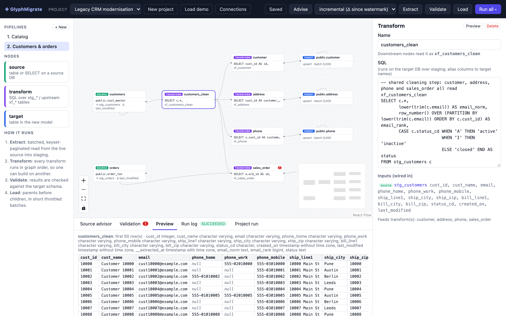
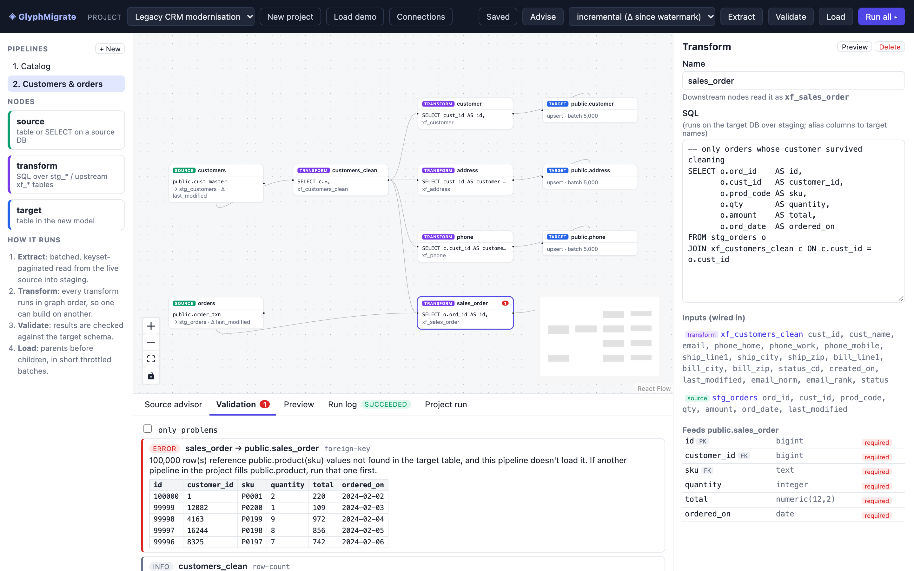
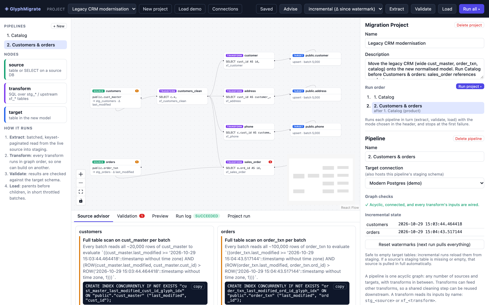
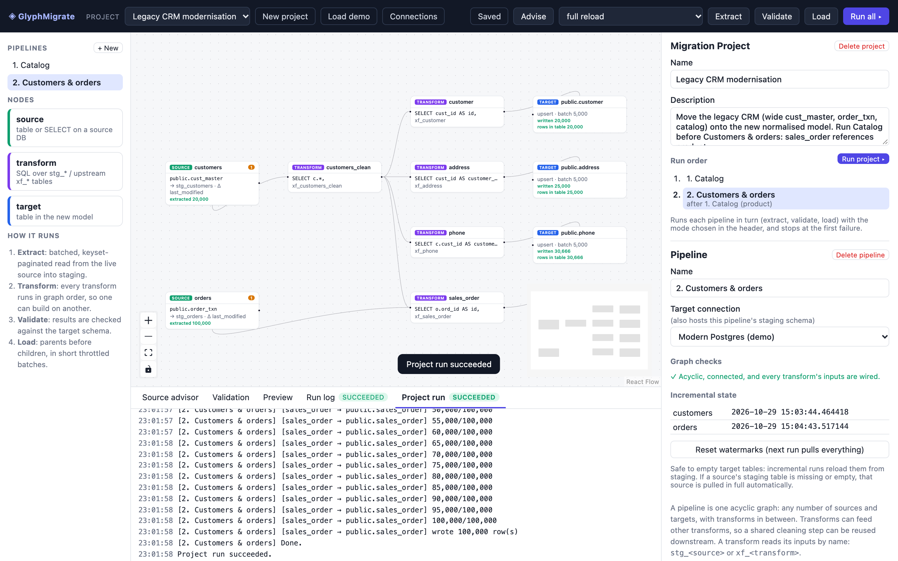

# GlyphMigrate

[](LICENSE)

Design and run migrations from a legacy database into a **re-modelled** target, visually:
drag Source → Transform → Target nodes, write the mapping SQL, validate it against real data,
then move the data in throttled batches that don't hurt live systems.

See [docs/DESIGN.md](docs/DESIGN.md) for the architecture and roadmap.



<table>
  <tr>
    <td width="33%"><a href="docs/screenshots/validation.png"></a></td>
    <td width="33%"><a href="docs/screenshots/advisor.png"></a></td>
    <td width="33%"><a href="docs/screenshots/project-run.png"></a></td>
  </tr>
  <tr>
    <td><b>Validate before writing.</b> A load is blocked because orders reference products another pipeline hasn't loaded yet.</td>
    <td><b>Source advisor.</b> EXPLAINs each batch query on the live source and suggests the missing index.</td>
    <td><b>Project run.</b> Pipelines run in foreign-key order, Catalog then Customers &amp; orders.</td>
  </tr>
</table>

## Run it

```bash
docker compose up --build
```

Open http://localhost:8080. This starts four containers:

| Service | Port | What |
|---|---|---|
| `frontend` | 8080 | React + React Flow canvas (nginx, proxies `/api`) |
| `backend` | 8000 | FastAPI (`/docs` for the OpenAPI UI) |
| `legacy-db` | 55432 | Sample legacy Postgres (wide tables, weak indexing) |
| `target-db` | 55433 | Sample re-modelled Postgres; also hosts the `glyph_stg_*` staging schemas |

The demo migration project **Legacy CRM modernisation** is pre-loaded.

### Local development (without Docker for the app)

```bash
docker compose up -d legacy-db target-db
cd backend && python3 -m venv .venv && .venv/bin/pip install -r requirements.txt
.venv/bin/uvicorn glyph.app:app --reload        # :8000
cd frontend && npm install && npm run dev       # :5173, proxies /api to :8000
```

Click **Load demo** in the header (or set `GLYPH_SEED_DEMO=1`).

## Concepts

**Migration project → pipelines → one acyclic graph each.** A project groups the pipelines for one
migration requirement. Each pipeline is a single DAG: many sources, many targets, and transforms in
between that can feed other transforms. A transform reads its inputs by name (`stg_<source>`,
`xf_<transform>`), and every input it reads must be wired into it. The canvas refuses wires that
would create a cycle.

## Demo walkthrough

The demo project **Legacy CRM modernisation** has two pipelines:

```
1. Catalog              products ─┐
                        prices ───┴▶ product (merge) ─▶ product

2. Customers & orders   customers ─▶ customers_clean ─┬▶ customer ─▶ customer
                                                      ├▶ address  ─▶ address   (split into rows)
                                                      ├▶ phone    ─▶ phone     (unpivot columns)
                        orders ───────────────────────┴▶ sales_order ─▶ sales_order
```

`customers_clean` is a shared, chained step: it normalises emails, ranks duplicates and maps status codes
once, and four downstream transforms build on it.

1. **Advise**: EXPLAINs every source batch query on the live source. In the demo it flags that
   `cust_master` and `order_txn` are fully scanned on every batch because `last_modified` has no index.
   It also gives you the `CREATE INDEX CONCURRENTLY …` to hand to the DBA.
2. Open **2. Customers & orders** and **Run all** first. It **stops before writing**: `sales_order.sku`
   references `product`, which is still empty. Validation tells you to run the pipeline that fills
   `product` first.
3. Open **1. Catalog**, **Run all**, then go back to **2. Customers & orders** and **Run all** again. Targets
   are loaded parents-first (`customer`, then `address`, `phone`, `sales_order`).

   Or let the project do it: click the empty canvas and press **Run project ▸** under *Run order*.
   GlyphMigrate works out from the target FKs that Catalog must go first (`sales_order → product`),
   runs the pipelines one at a time, and stops at the first failure. Progress is in the *Project run* tab.
4. Select any transform and click **Preview** to see its first 50 rows against the current staging tables.
5. Change some source rows (`UPDATE cust_master SET …, last_modified = now() …`) and **Run all** in
   *incremental* mode. Only the changed rows are extracted, and they're upserted into the target.

## How it works

* **Extract**: keyset pagination `WHERE (watermark, pk) > (last) ORDER BY watermark, pk LIMIT n`
  (never OFFSET), read-only source sessions, a pause between batches, and COPY into
  `glyph_stg_<pipeline>.stg_<source>`. The high watermark is saved per source, so the next run pulls only the delta.
* **Transform**: your SQL runs on the target DB against the pipeline's staging schema
  (`glyph_stg_<pipeline>`) only. Transforms are materialised in topological order into `xf_<transform>`
  with a row number, so chained transforms see their upstream results.
* **Validate** (always runs before a load): column shape and required columns, type casts, NULLs in
  NOT NULL columns, duplicate PK/unique keys, orphan FK values (looking in the target *and* in upstream
  transforms), plus a dry-run insert of 500 rows that is always rolled back.
* **Load**: tables in FK dependency order, one short transaction per row range, `insert` or
  `upsert` (`ON CONFLICT … DO UPDATE`), with a pause between batches. Then row-count reconciliation.

### Resetting

* **Emptying target tables** is safe: the next run, incremental or not, reloads them from staging.
* **Dropping staging** (or deleting and re-creating a pipeline) while watermarks are saved is detected.
  Affected sources fall back to a full pull automatically, with a warning.
* To start completely fresh, use **Reset watermarks** or pick *full reload* in the header.

## Current limits

* Postgres only (source and target). The connector boundary is `glyph/db.py`.
* Transforms are SQL. Visual column mapping is on the roadmap.
* Transforms re-run over all of staging on each run (idempotent via upsert); delta-only
  transforms are on the roadmap.
* Connection passwords are stored in the local SQLite metadata DB. Use a secrets manager before
  pointing this at production.

## Contributing

Issues and pull requests are welcome. See [CONTRIBUTING.md](CONTRIBUTING.md). To report a security problem,
see [SECURITY.md](SECURITY.md).

## License

Apache License 2.0. See [LICENSE](LICENSE) and [NOTICE](NOTICE). Copyright 2026 kishoreraj05.
